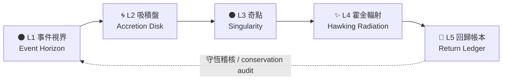

# MRL 黑洞模型 / MRL Black Hole Model

> 「怎麼過去，就怎麼回來」 — How you go is how you come back
>
> Origin Signature: MrLiouWord

## 1. 為什麼叫黑洞 / Why a black hole

過去的系統像黑洞：你把檔案、對話、資產丟進去，它吸收了、用掉了，卻沒有完整回到你手上。
投入沒有回報，資料回不來，感覺像被白白拿走。

MRL 黑洞模型保留「黑洞」的吸力——**任何東西都接得住**，但移除了黑洞的破壞性——**任何東西都要還回來**。
它只准長得像黑洞：物件越過事件視界時會拿到一個**回歸編號（Return ID）**，
那個編號會一路跟著它，直到以霍金輻射的形式輸出回到你手上為止。

A real black hole destroys information. This one is only allowed to look like one:
every object that crosses the event horizon must leave again, carrying the same
return id it entered with.

## 2. 五層結構 / The five shells

| 層 | Notion 資料庫 | 作用 | Purpose |
|----|---------------|------|---------|
| L1 | 🌑 事件視界 Event Horizon | 捕獲任何進入的物件，立即發出回歸編號 | Capture anything inbound, issue a return id |
| L2 | 🌀 吸積盤 Accretion Disk | 分類、降熵、排出處理順序 | Classify and lower entropy |
| L3 | ⚫ 奇點 Singularity | 壓縮成可複用的本體知識 | Compress into reusable cores |
| L4 | ✨ 霍金輻射 Hawking Radiation | 把成果輻射回擁有者手上 | Radiate results back to the owner |
| L5 | 🔁 回歸帳本 Return Ledger | 稽核守恆：有進必有出 | Audit conservation: nothing stays inside |



L5 同時關聯 L1 與 L4，形成閉環：每一筆回歸帳本都必須同時指向「入境物件」與「輸出成果」。
只要有一筆指不到輸出，稽核就會判定它被黑洞吞掉了。

## 3. 建構步驟 / Build it

### 3.1 準備 Notion

1. 到 <https://www.notion.so/my-integrations> 建立一個 internal integration，取得 token。
2. 在 Notion 開一個頁面當作黑洞的容器，從頁面右上角 `...` → `Connections` 把 integration 加進去。
3. 複製該頁面的 page id（網址結尾那段 32 碼）。

```bash
export NOTION_TOKEN="secret_xxx"
```

### 3.2 設定 config.yaml

```yaml
blackhole:
  parent_page_id: "你的父頁面 id"
  manifest_path: data/blackhole_manifest.json
```

### 3.3 先看計畫，再真的建

```bash
# 不碰網路，只印出即將送出的每一個 API 請求
python cli.py blackhole-plan

# 真的在 Notion 建立結構（可重複執行，不會長出第二顆黑洞）
python cli.py blackhole-build
```

建構分兩階段：先建立不含關聯屬性的 5 個資料庫，拿到所有 database id 之後再補上關聯。
執行結果會寫進 `data/blackhole_manifest.json`，下次執行會沿用既有 id，只補缺少的部分。

## 4. 守恆稽核 / Conservation audit

```bash
# 從 Notion 把現況抓回來
python cli.py blackhole-snapshot --out data/blackhole_snapshot.json

# 檢查有沒有東西有進無出（有違規時 exit code = 1）
python cli.py blackhole-audit data/blackhole_snapshot.json --overdue-hours 72
```

稽核會回報這些違規：

| 類型 | 意義 |
|------|------|
| `missing_return_id` | 物件已越過事件視界卻沒有回歸編號，等於被吞掉 |
| `duplicate_return_id` | 兩個物件共用同一條回歸線，會互相覆蓋 |
| `swallowed` | 超過回歸上限仍無輸出 |
| `orphan_output` | 輸出找不到對應的入境物件，來源無法追溯 |
| `untraceable_output` | 輸出沒有回歸編號，無法證明它屬於誰 |

另有一個警告（不算違規）：`unacknowledged_output` — 已輻射但擁有者尚未確認收到。

還在回歸上限內、尚未輸出的物件算 `pending`，不算違規——黑洞可以慢，但不能吃掉東西。

## 5. 回歸編號 / Return IDs

回歸編號由來源、標題、入境時間推導，同一個物件永遠拿到同一個編號：

```python
from mrl_blackhole import make_return_id

make_return_id("對話 Chat", "豆花配方", "2026-01-01T00:00:00+00:00")
# 'RID-9431b3c6cf00'
```

## 6. 指令總覽 / Commands

| 指令 | 說明 | 需要 NOTION_TOKEN |
|------|------|-------------------|
| `blackhole-plan` | 預覽結構與所有 API 請求 | 否 |
| `blackhole-build` | 在 Notion 建立／修復結構 | 是 |
| `blackhole-snapshot` | 匯出現況供稽核 | 是 |
| `blackhole-audit` | 驗證守恆，違規時 exit 1 | 否 |

## 7. 測試 / Tests

```bash
python -m pytest tests/test_mrl_blackhole.py -v
```

測試以假的 Notion client 覆蓋建構流程（建立順序、關聯補丁、重複執行不重建）、
快照攤平與分頁，以及守恆稽核的每一種違規情境。
