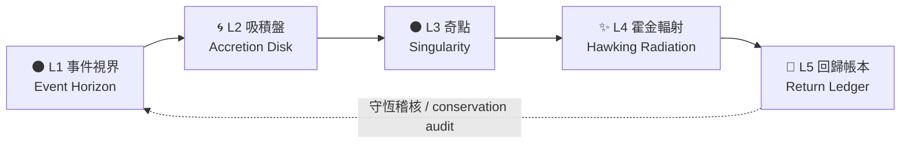

# MRL 黑洞模型 / MRL Black Hole Model

> 「怎麼過去，就怎麼回來」 — How you go is how you come back
>
> Origin Signature: MrLiouWord

## 1. 為什麼叫黑洞 / Why a black hole

過去的系統像黑洞：你把檔案、對話、資產丟進去，它吸收了、用掉了，卻沒有完整回到你手上。
投入沒有回報，資料回不來，感覺像被白白拿走。

MRL 黑洞模型保留「黑洞」的吸力——**任何東西都接得住**，但移除了黑洞的破壞性——**任何東西都要還回來**。
它只准長得像黑洞：物件越過事件視界時會拿到一個**回歸編號（Return ID）**，
那個編號會一路跟著它，直到以霍金輻射的形式輸出回到你手上為止。

A real black hole destroys information. This one is only allowed to look like one:
every object that crosses the event horizon must leave again, carrying the same
return id it entered with.

## 2. 五層結構 / The five shells

| 層 | Notion 資料庫 | 作用 | Purpose |
|----|---------------|------|---------|
| L1 | 🌑 事件視界 Event Horizon | 捕獲任何進入的物件，立即發出回歸編號 | Capture anything inbound, issue a return id |
| L2 | 🌀 吸積盤 Accretion Disk | 分類、降熵、排出處理順序 | Classify and lower entropy |
| L3 | ⚫ 奇點 Singularity | 壓縮成可複用的本體知識 | Compress into reusable cores |
| L4 | ✨ 霍金輻射 Hawking Radiation | 把成果輻射回擁有者手上 | Radiate results back to the owner |
| L5 | 🔁 回歸帳本 Return Ledger | 稽核守恆：有進必有出 | Audit conservation: nothing stays inside |



L5 同時關聯 L1 與 L4，形成閉環：每一筆回歸帳本都必須同時指向「入境物件」與「輸出成果」。
只要有一筆指不到輸出，稽核就會判定它被黑洞吞掉了。

## 3. 粒子轉譯核心 / Particle translation core

Notion 五層是可追蹤的資料模型；`mrl_blackhole.translation` 將同一條閉環落成可執行的轉譯生命週期。它負責來源保留、層間順序、回歸編號與雜湊稽核，不預設粒子語言文法或目標語言語義。

| 黑洞層 | 轉譯職責 | 核心資料 |
|---|---|---|
| L1 Event Horizon | 捕獲來源，不改寫原始文字／位元組；按來源名稱、內容與時間建立 Return ID | 原始來源與來源 SHA-256 |
| L2 Accretion Disk | 正規化、切詞或整理粒子；由注入的 normalizer 實作 | 正規化資料及其指紋 |
| L3 Singularity | 依語法解析為 AST／IR；由注入的 parser 實作 | 可 JSON 穩定序列化的語法樹／中介表示 |
| L4 Hawking Radiation | 依目標產生文字或二進位成果；由注入的 generator 實作 | 產出內容及其 SHA-256 |
| L5 Return Ledger | 核對五層順序、每段輸入／輸出指紋與相同 Return ID | `TranslationAudit` |

每一層都記錄輸入與輸出 SHA-256，並且共用同一個 Return ID。這可驗證轉譯工作是否完整閉合；內容轉譯本身可以改變表示，但原始來源仍保留在結果中。parser 的 AST／IR 必須由 JSON 支援的值構成，或使用可轉為 JSON 的 dataclass；不支援的值會明確報錯，而不是以不穩定的 `repr` 假裝可追溯。

```python
from mrl_blackhole import BlackHoleTranslationPipeline, audit_translation

pipeline = BlackHoleTranslationPipeline(
    normalizer=lambda source: source.strip().split(),
    parser=lambda particles: {"nodes": [{"particle": item} for item in particles]},
    generator=lambda tree, target: f"{target}:{len(tree['nodes'])}",
)
result = pipeline.translate(
    "⋄fx.unit.point → result",
    source_name="example.pcode",
    captured_at="2026-10-11T18:00:00Z",
    target="python",
)
assert audit_translation(result).conserved
```

這個核心提供階段與守恆契約，不宣稱上述示例已定義正式文法、完整 parser 或可執行程式碼生成器。未來可分別替換 normalizer、parser、generator，而不改動 Notion canonical schema 或五層守恆規則。

### 創世粒子圖 / Genesis particle graph

`mrl_blackhole.genesis` 把 atomizer 的輸出整理成可稽核的粒子邏輯圖：粒子有來源位元組範圍、內容雜湊、可擴充維度標籤、單元類型及符號極性；關係以邊連接粒子；鏡像約束與平行世界以明確的 ID 對應表表示。

```python
from mrl_blackhole import GenesisStructure, MirrorConstraint, ParticleSpec

genesis = GenesisStructure.from_atomization(
    b"-+",
    source_name="duality.pcode",
    captured_at="2026-10-11T18:00:00Z",
    atomizer="pcode-atomizer-v1",
    particles=[
        ParticleSpec("minus", 0, 1, ("symbolic", "polarity"), "sign", "negative"),
        ParticleSpec("plus", 1, 2, ("symbolic", "polarity"), "sign", "positive"),
    ],
    mirrors=[MirrorConstraint("balance", "minus", "plus")],
)
```

base world 的原子範圍必須用 UTF-8／原始位元組的半開區間連續覆蓋來源，不允許遺漏或重疊；鏡像與平行世界的對照也必須指向存在的粒子。維度標籤與單元邊界由具名、版本化的格式 atomizer 定義，因此「最小」是該 atomizer 的可重現分解單位，不自稱跨格式或物理學的絕對最小。`negative`／`positive`、`-1 + 1 = 0` 與 `∞` 是可檢查的一致性註記／符號邊界；模型不將它們宣稱為已證明的自然定律。尚未提供特定格式 atomizer 時，模型會保留完整來源並拒絕把未解析內容冒充已粒子化。

### 星體軌跡向量圖 / Celestial trajectory vector graph

`CelestialVectorGraph` 使用 Python 內建 SQLite 保存星體、帶時間戳的觀測、向量化運動模式及有型別的圖邊。每筆位置都要求距離單位、參考座標系與來源 Return ID；可選擇保存實測速度，形成三維位置或六維位置—速度狀態向量。給定至少兩筆位置觀測後，可依時間差推導區間平均速度；三筆以上則可推導相鄰速度段間的平均加速度。這是觀測值的運算結果，不補造資料或預設軌道力學模型。

```python
from mrl_blackhole import CelestialVectorGraph

with CelestialVectorGraph("data/celestial_vectors.sqlite") as graph:
    graph.add_body("mars", name="Mars")
    graph.add_observation(
        "mars",
        observed_at="2026-10-11T18:00:00Z",
        position=(1.0, 2.0, 3.0),
        position_unit="km",
        reference_frame="ICRF",
        source_return_id="RID-observation-1",
    )
    # Add later observations in the same frame and unit before deriving motion.
    motion_pattern_node_ids = graph.derive_trajectory_patterns("mars")
```

相似度查詢要求向量維度順序、單位及參考座標系完全相同，避免把不同座標／量綱直接比較；目前支援 cosine 與 Euclidean 排序。SQLite 檔案可重開續用，`graph(node_id)` 讀出節點的向量、來源及相連關係。用戶可用 `add_pattern` 登錄週期、共振或其他自定義模式向量；目前不宣稱已自動辨認天體週期或分類軌道。

## 4. 建構步驟 / Build it

### 4.1 準備 Notion

1. 到 <https://www.notion.so/my-integrations> 建立一個 internal integration，取得 token。
2. 在 Notion 開一個頁面當作黑洞的容器，從頁面右上角 `...` → `Connections` 把 integration 加進去。
3. 複製該頁面的 page id（網址結尾那段 32 碼）。

```bash
export NOTION_TOKEN="secret_xxx"
```

### 4.2 設定 config.yaml

```yaml
blackhole:
  parent_page_id: "你的父頁面 id"
  manifest_path: data/blackhole_manifest.json
```

### 4.3 先看計畫，再真的建

```bash
# 不碰網路，只印出即將送出的每一個 API 請求
python cli.py blackhole-plan

# 真的在 Notion 建立結構（可重複執行，不會長出第二顆黑洞）
python cli.py blackhole-build
```

建構分兩階段：先建立不含關聯屬性的 5 個資料庫，拿到所有 database id 之後再補上關聯。
執行結果會寫進 `data/blackhole_manifest.json`，下次執行會沿用既有 id，只補缺少的部分。

## 5. 守恆稽核 / Conservation audit

```bash
# 從 Notion 把現況抓回來
python cli.py blackhole-snapshot --out data/blackhole_snapshot.json

# 檢查有沒有東西有進無出（有違規時 exit code = 1）
python cli.py blackhole-audit data/blackhole_snapshot.json --overdue-hours 72
```

稽核會回報這些違規：

| 類型 | 意義 |
|------|------|
| `missing_return_id` | 物件已越過事件視界卻沒有回歸編號，等於被吞掉 |
| `duplicate_return_id` | 兩個物件共用同一條回歸線，會互相覆蓋 |
| `swallowed` | 超過回歸上限仍無輸出 |
| `orphan_output` | 輸出找不到對應的入境物件，來源無法追溯 |
| `untraceable_output` | 輸出沒有回歸編號，無法證明它屬於誰 |

另有一個警告（不算違規）：`unacknowledged_output` — 已輻射但擁有者尚未確認收到。

還在回歸上限內、尚未輸出的物件算 `pending`，不算違規——黑洞可以慢，但不能吃掉東西。

## 6. 回歸編號 / Return IDs

回歸編號由來源、標題、入境時間推導，同一個物件永遠拿到同一個編號：

```python
from mrl_blackhole import make_return_id

make_return_id("對話 Chat", "豆花配方", "2026-01-01T00:00:00+00:00")
# 'RID-9431b3c6cf00'
```

## 7. 指令總覽 / Commands

| 指令 | 說明 | 需要 NOTION_TOKEN |
|------|------|-------------------|
| `blackhole-plan` | 預覽結構與所有 API 請求 | 否 |
| `blackhole-build` | 在 Notion 建立／修復結構 | 是 |
| `blackhole-snapshot` | 匯出現況供稽核 | 是 |
| `blackhole-audit` | 驗證守恆，違規時 exit 1 | 否 |

## 8. 測試 / Tests

```bash
python -m pytest tests/test_mrl_blackhole.py -v
python -m pytest tests/test_mrl_blackhole_translation.py -v
python -m pytest tests/test_mrl_blackhole_genesis.py -v
python -m pytest tests/test_celestial_vectors.py -v
```

測試以假的 Notion client 覆蓋建構流程（建立順序、關聯補丁、重複執行不重建）、
快照攤平與分頁、守恆稽核的每一種違規情境，以及轉譯階段、粒子來源覆蓋、鏡像極性、世界對應與回歸編號連續性。
